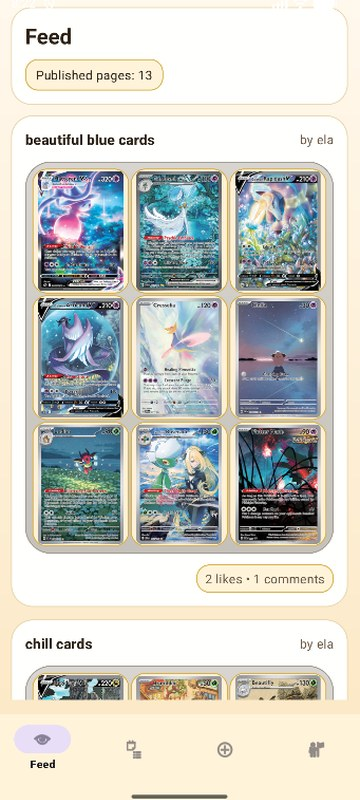
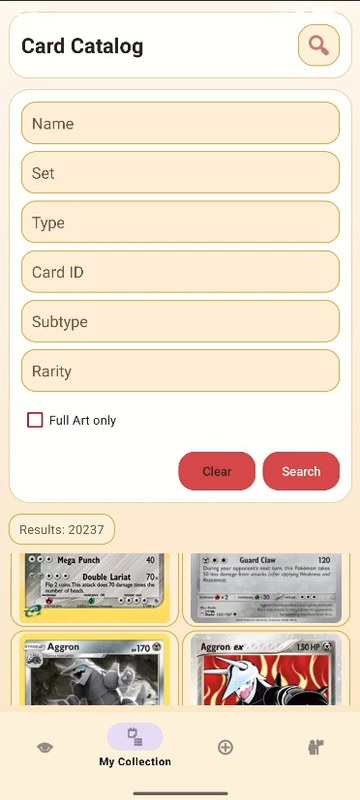
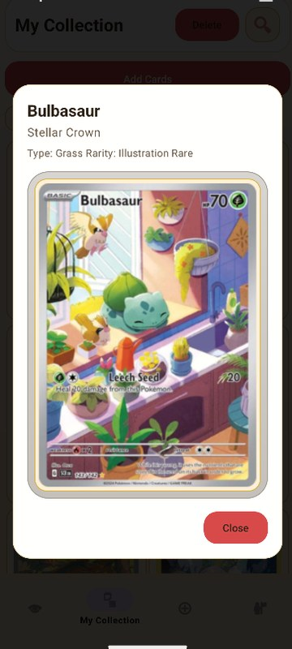
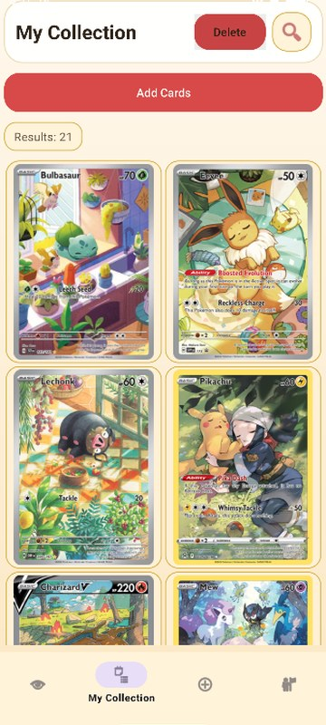
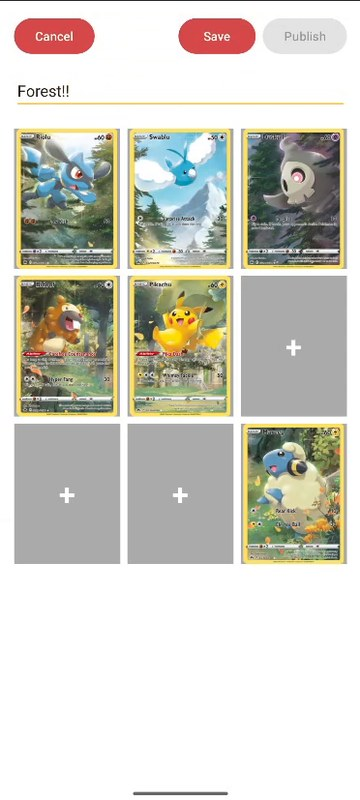
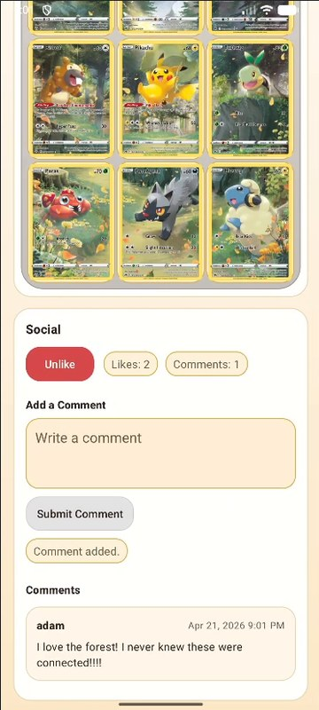

# PokeBinder

**A Pokémon card binder-building and sharing Android app.**

Browse a bundled catalog of 20,237 Pokémon cards, save favorites to your collection, arrange them into themed 3×3 binder pages, and publish finished pages to a shared feed where other users can like and comment.


## Screenshots

<table>
  <tr>
    <td align="center"><br><sub><b>Feed</b></sub></td>
    <td align="center"><br><sub><b>Card search</b> (20,237 cards)</sub></td>
    <td align="center"><br><sub><b>Card preview</b></sub></td>
  </tr>
  <tr>
    <td align="center"><br><sub><b>Collection</b></sub></td>
    <td align="center"><br><sub><b>Binder editor</b></sub></td>
    <td align="center"><br><sub><b>Likes &amp; comments</b></sub></td>
  </tr>
</table>

## Features

- **Card search:** filter all 20,237 cards by name, set, type, card ID, subtype and rarity, with autocomplete suggestions. A "Full Art only" toggle approximates full-art cards from their rarity text, since the source data has no full-art flag.
- **Card previews:** tap a card to see a larger image with its set, type and rarity.
- **Collection:** save and remove cards. Each user's collection is stored in Firestore and can be searched with the same filters.
- **Binder editor:** each binder is one 3×3 page. Pick a slot, multi-select cards from your collection, and they fill the page in the order you chose them. Remove or replace any card.
- **Drafts and publishing:** save unfinished pages as private drafts and come back to them later. Publishing requires a title and all nine slots filled. The Binders screen searches by title, filters drafts and published pages, and deletes pages.
- **Feed, likes and comments:** published pages show up in a shared feed. Open a page to like it or leave a comment.
- **Profile:** see how many pages you've published and how many likes and comments they got, and browse the pages you've liked or commented on.

## How it works

### Architecture

```
Fragments (XML views + Navigation)
  → ViewModels (LiveData)
    → Repositories (Auth, User, Card, Collection, BinderPage, Social)
      → Firebase Authentication + Cloud Firestore
      → bundled card catalog (assets/pokemon_cards.json, parsed with Gson)
```

The app uses a single activity with one fragment and one ViewModel per screen. Repositories handle all Firebase and catalog access, and Glide loads the card images.

### Firestore data model

```
users/{userId}                    username, email
  savedCards/{cardId}             the user's collection
  binderDraftPages/{pageId}       private drafts: title + 9 slots
binderPublishedPages/{pageId}     shared pages: owner, title, 9 slots, likeCount, commentCount
  likes/{userId}                  one doc per user who liked the page
  comments/{commentId}            userId, display name, text, createdAt
```

- **Publishing** runs in a transaction that writes the published page and deletes the draft it came from.
- **Likes and comments** are transactions that write the like or comment and update the page's counter together. Like docs are keyed by user ID, so each user can like a page once.
- **The feed and page detail** use snapshot listeners, so new pages, likes and comments appear without a refresh.
- **Your Likes / Your Comments** are collection-group queries on `likes` and `comments`, filtered by `userId`.
- **Deleting** a published page removes its likes and comments in the same batch.

### Card catalog pipeline

`pokemon_cards.py` pages through the [Pokémon TCG API](https://pokemontcg.io/) `/v2/cards` endpoint, 250 cards per page. It keeps each card's ID, name, small image URL, set name, types, subtypes and rarity, sorts the cards by name, set and ID, and writes the result to `PokeBinder/app/src/main/assets/pokemon_cards.json` (20,237 cards across 173 set names).

The app loads that file with Gson and searches it in memory, so card search never calls the API. Each of the six search fields is a case-insensitive substring match, and the fields are combined with AND. Autocomplete suggests up to 8 distinct values, with prefix matches first. Card images are still loaded from their URLs over the network.

### Binder placement

A page is nine indexed slots stored as `{index, cardId}`, separate from the views. When you pick a starting slot and multi-select cards (the picker limits you to the number of open slots), each card goes into the next empty slot. Placement starts at the chosen slot, skips slots that already hold a card, and wraps from the last slot back to the first.

## Tech stack

- **App:** Kotlin, Android XML views, Material Components
- **AndroidX:** Navigation, ViewModel, LiveData, RecyclerView
- **Firebase:** Authentication (email/password) and Cloud Firestore (Firebase BoM 34.12.0)
- **Libraries:** Gson, Glide
- **Build:** Gradle 9.3.1 (Kotlin DSL), AGP 9.1.1, minSdk 26, targetSdk 36
- **Catalog importer:** Python 3.10+ with `requests`

## Getting started

The repo doesn't include a Firebase config, so you'll connect the app to your own Firebase project.

1. **Clone** the repo and open the `PokeBinder/` folder in a recent Android Studio that supports AGP 9.1.1. The Gradle daemon is set to use JDK 21.
2. **Create a Firebase project** in the [Firebase console](https://console.firebase.google.com/):
   1. Add an Android app with package name `com.adamjohnson.pokebinder`.
   2. Download its `google-services.json` into `PokeBinder/app/`. The file is gitignored.
   3. Under **Authentication → Sign-in method**, enable **Email/Password**.
   4. Create a **Cloud Firestore** database and add the rules below.
3. **Sync Gradle and run** on an emulator or a device with API 26 or higher. Create an account in the app to get started.

If **Your Likes** or **Your Comments** shows an index error, open the link in the error message to enable the collection-group index on `userId` for `likes` and `comments`.

<details>
<summary><b>Starter Firestore rules</b></summary>

These rules are a starting point based on the collections the app uses. Review and test them before you rely on them.

```
rules_version = '2';
service cloud.firestore {
  match /databases/{database}/documents {

    function signedIn() { return request.auth != null; }

    // Profile, saved cards and private drafts: owner only
    match /users/{userId}/{document=**} {
      allow read, write: if signedIn() && request.auth.uid == userId;
    }

    match /binderPublishedPages/{pageId} {
      function isPageOwner() {
        return signedIn() &&
          get(/databases/$(database)/documents/binderPublishedPages/$(pageId)).data.ownerUserId == request.auth.uid;
      }

      allow read: if signedIn();
      allow create: if signedIn() && request.resource.data.ownerUserId == request.auth.uid;
      allow delete: if signedIn() && resource.data.ownerUserId == request.auth.uid;
      // Owners can edit their page; other users can only change the counters
      allow update: if signedIn() && (
        resource.data.ownerUserId == request.auth.uid ||
        request.resource.data.diff(resource.data).affectedKeys().hasOnly(['likeCount', 'commentCount'])
      );

      match /likes/{likerId} {
        allow read: if signedIn();
        allow create: if signedIn() && request.auth.uid == likerId;
        allow delete: if signedIn() && (request.auth.uid == likerId || isPageOwner());
      }

      match /comments/{commentId} {
        allow read: if signedIn();
        allow create: if signedIn() && request.resource.data.userId == request.auth.uid;
        allow delete: if isPageOwner();
      }
    }

    // Collection-group queries for "Your Likes" / "Your Comments"
    match /{path=**}/likes/{likeId} {
      allow read: if signedIn();
    }
    match /{path=**}/comments/{commentId} {
      allow read: if signedIn();
    }
  }
}
```

</details>

### Optional: regenerate the card catalog

From the repo root (Python 3.10+):

```bash
pip install requests
python pokemon_cards.py
```

This overwrites `PokeBinder/app/src/main/assets/pokemon_cards.json` with a fresh pull from the API.

## Project structure

```
pokebinder/
├── pokemon_cards.py                  # catalog importer (Pokémon TCG API → JSON)
├── docs/screenshots/
└── PokeBinder/                       # Android Studio project
    └── app/src/main/
        ├── assets/pokemon_cards.json # bundled card catalog
        ├── java/com/adamjohnson/pokebinder/
        │   ├── MainActivity.kt, *Fragment.kt   # one fragment per screen
        │   ├── viewmodel/            # one ViewModel per screen
        │   ├── data/repository/      # Auth, User, Card, Collection, BinderPage, Social
        │   ├── data/local/           # catalog asset loader
        │   ├── model/                # BinderPage, BinderSlot, PokemonCard, Comment, ...
        │   └── ui/                   # RecyclerView adapters, card preview dialog
        └── res/                      # layouts, navigation graph, drawables
```

## About

Built as my final project for UT Austin CS 386P (Spring 2026).

Card data and images come from the [Pokémon TCG API](https://pokemontcg.io/). Pokémon and all related names and images are © Nintendo, Creatures Inc., GAME FREAK inc. and The Pokémon Company. This is a non-commercial student project and isn't affiliated with or endorsed by any of them.

## License

All rights reserved. No open-source license is granted.
